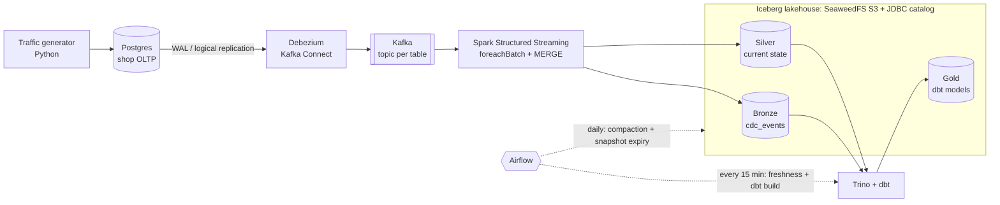

# E-commerce CDC Pipeline

Real-time **Change Data Capture** pipeline that mirrors an operational Postgres database into an
**Apache Iceberg lakehouse** within seconds, keeps the full history of every change, and builds
tested analytics models on top of it, orchestrated with **Airflow**.

Fully local and free: every component runs in Docker Compose. Every component also has a direct
cloud equivalent (S3, Glue Catalog, Athena, MSK, MWAA), so the design is cloud-ready.

## Architecture



| Layer | Table(s) | Content |
| --- | --- | --- |
| Bronze | `bronze.cdc_events` | Every Debezium change event with the raw JSON payload: full, append-only history |
| Silver | `silver.customers`, `products`, `orders`, `order_items` | Current state of the source tables (insert / update / delete applied with `MERGE`) |
| Gold | `gold.fct_orders`, `fct_order_items`, `dim_customers`, `dim_products_scd2`, `mart_daily_revenue` | Analytics models built with dbt on Trino |

## Tech stack

| Area | Tool | Cloud equivalent |
| --- | --- | --- |
| Source database | Postgres 17 (logical replication) | Amazon RDS |
| CDC | Debezium 3.4 on Kafka Connect | AWS DMS |
| Event log | Apache Kafka 4.1 (KRaft) | Amazon MSK |
| Stream processing | Spark 4.1 Structured Streaming (PySpark) | AWS Glue / EMR |
| Table format | Apache Iceberg 1.11 | Iceberg on S3 |
| Object storage | SeaweedFS (S3 API) | Amazon S3 |
| Catalog | Iceberg JDBC catalog in Postgres | AWS Glue Data Catalog |
| Query engine | Trino 482 | Amazon Athena (built on Trino) |
| Transformations and tests | dbt (dbt-trino) | same |
| Orchestration | Apache Airflow 3.3 | Amazon MWAA |
| CI | GitHub Actions (ruff, compose validation, dbt parse) | same |

## Key design decisions

- **CDC from the WAL, not polling.** Debezium reads Postgres logical replication through a replication
  slot, so inserts, updates and deletes are all captured without any load from queries on the source tables.
  `REPLICA IDENTITY FULL` gives full `before` images, which delete handling and change analysis need.
- **Least privilege and no secrets in the repo.** Debezium uses a dedicated `REPLICATION` user. Passwords come from
  `.env` and are injected at runtime (`${env:...}` config provider in Kafka Connect, `${ENV:...}` in Trino,
  a rendered config template in Spark).
- **`foreachBatch` + `MERGE INTO`.** The built-in streaming sink can only append. CDC needs updates and deletes,
  so every 10-second micro-batch is processed as a regular DataFrame and applied with Iceberg `MERGE`.
- **Deduplication per micro-batch.** A row can change several times within one batch. Only its latest
  version (highest LSN) is merged, because `MERGE` rejects multiple source rows for one target row.
- **Effectively exactly-once.** Spark checkpoints give at-least-once processing. Writes are idempotent:
  bronze merges on Kafka coordinates (topic, partition, offset), and silver only applies an event when its LSN is
  newer than or equal to the stored one. A replayed batch therefore cannot duplicate or roll back data.
- **SCD2 from the change log.** `dim_products_scd2` is built from every price change in bronze, ordered by WAL
  position, instead of from periodic snapshots that would miss intermediate changes.
- **Two engines, one table format.** Spark writes and Trino reads the same Iceberg tables through a shared JDBC
  catalog. Neither engine owns the data.
- **Freshness gate before publishing.** The `dbt_gold` DAG runs `dbt source freshness` first. If streaming has
  stopped, the run fails before stale data is published as fresh gold tables.
- **Table maintenance as code.** Streaming creates many small files and snapshots. A daily DAG runs Iceberg
  `optimize`, `expire_snapshots` and `remove_orphan_files` through Trino (a dbt macro), one task per table with
  retries, because maintenance commits can conflict with concurrent streaming `MERGE` commits.
- **Persistent state everywhere.** The Kafka log, Connect internal topics (compacted), Spark checkpoints, Iceberg
  data and catalog all live in Docker volumes, so the pipeline resumes exactly where it stopped.

## Incident: silent data loss caught by a data test

While moving Kafka to a persistent volume, the topics were recreated empty, but the still-running Connect worker
wrote its last source offset into the new (auto-created) offsets topic. On restart Debezium saw a stored offset,
skipped the initial snapshot and only streamed new changes, so rows that existed before and never changed
again were missing from the lakehouse.

The dbt `relationships` test between `fct_orders` and `dim_customers` failed with 847 orphaned orders. Root cause
analysis compared Postgres, silver and bronze: bronze contained no snapshot (`op = r`) events for customers.

**Fix without downtime:** a Debezium signaling table (`ecommerce.debezium_signal`) and an **incremental snapshot**
of the four tables, triggered with a single `INSERT`. Debezium interleaves snapshot chunks with live changes
using watermarks, and the LSN guard in the silver `MERGE` prevents older snapshot rows from overwriting newer
state. After the snapshot all tests passed again.

**Lessons:** pipeline state is spread across several systems (Kafka data, connector offsets, Spark checkpoints)
and must be persisted and reset together. Topic auto-creation hides mistakes: in production it is disabled and
internal topics are created explicitly.

## Getting started

Requirements: Docker Desktop with about 20 GB RAM available to containers.

```bash
cp .env.example .env              # then set your own passwords
docker compose up -d --build
```

Register the Debezium connector (once; its configuration is stored in Kafka afterwards):

```bash
curl -X PUT -H "Content-Type: application/json" \
  --data @connectors/ecommerce-postgres.json \
  http://localhost:8083/connectors/ecommerce-postgres/config
```

PowerShell:

```powershell
$config = Get-Content -Raw connectors\ecommerce-postgres.json
Invoke-RestMethod -Method Put -Uri "http://localhost:8083/connectors/ecommerce-postgres/config" -ContentType "application/json" -Body $config
```

The streaming job (`cdc-streaming`) starts automatically and picks up events as soon as the connector produces them.
Airflow (http://localhost:8082) then refreshes the gold layer every 15 minutes and runs maintenance daily.
dbt can also be run manually:

```bash
docker exec dbt dbt build              # models + data tests
docker exec dbt dbt source freshness   # is streaming still delivering data?
```

Ad-hoc re-snapshot of tables (recovery), without stopping the pipeline:

```sql
INSERT INTO ecommerce.debezium_signal (id, type, data)
VALUES ('resnapshot-1', 'execute-snapshot',
        '{"data-collections": ["ecommerce.customers", "ecommerce.orders"], "type": "incremental"}');
```

## Verifying the pipeline

Compare the source with the lakehouse (they match within the 10-second trigger interval):

```bash
docker exec postgres psql -U shop -d shop -c "SELECT status, count(*) FROM ecommerce.orders GROUP BY 1 ORDER BY 1;"
docker exec trino trino --execute "SELECT status, count(*) FROM lakehouse.silver.orders GROUP BY 1 ORDER BY 1"
```

Price history of a product (SCD2):

```sql
SELECT sku, price_version, price, valid_from, valid_to, is_current
FROM lakehouse.gold.dim_products_scd2
WHERE sku = 'ELEC-001'
ORDER BY price_version;
```

## Services

| Service | URL / port |
| --- | --- |
| Postgres | `localhost:5432` |
| Kafka (external listener) | `localhost:29092` |
| Kafka Connect REST API | http://localhost:8083 |
| Kafbat UI | http://localhost:8090 |
| SeaweedFS S3 API / file browser | `localhost:8333` / http://localhost:8888 |
| Spark UI (streaming job) | http://localhost:4041 |
| Trino (SQL, e.g. DataGrip) | `localhost:8088`, catalog `lakehouse` |
| Airflow | http://localhost:8082 |
| dbt docs (`dbt docs serve --host 0.0.0.0 --port 8081`) | http://localhost:8081 |

## Project structure

```
├── docker-compose.yml
├── postgres/init/          # schema, seed data, Debezium user and signaling table, catalog and Airflow databases
├── generator/              # Python traffic generator (inserts, updates, deletes)
├── connectors/             # Debezium connector configuration
├── spark/
│   ├── conf/               # Spark + Iceberg configuration template
│   └── jobs/               # cdc_to_iceberg.py: Kafka -> bronze + silver
├── trino/catalog/          # Trino Iceberg catalog (same JDBC catalog and S3 as Spark)
├── dbt/                    # gold models, data tests, source freshness, Iceberg maintenance macro
├── airflow/dags/           # dbt_gold (every 15 min), iceberg_maintenance (daily)
└── .github/workflows/      # CI: ruff, compose validation, dbt parse
```

## Known limitations and next steps

- **Bronze `MERGE` cost grows with the table.** At larger scale bronze would switch to plain appends with
  deduplication downstream, or restrict the merge to recent partitions.
- **Snapshots do not replay deletes.** Rows deleted while the pipeline was fully down are not re-emitted by a new
  snapshot, so such an incident requires a full silver reload, not only an incremental snapshot.
- **Gold is rebuilt in full.** Fine at this data volume; incremental dbt models would be the next step at scale.
- **Local-only security.** No TLS or authentication between services, and Airflow runs without login. A cloud
  deployment would use IAM roles, Secrets Manager and managed services instead.
- **SCD2 tracks price only.** The generator changes prices; other product attributes are not versioned separately.
